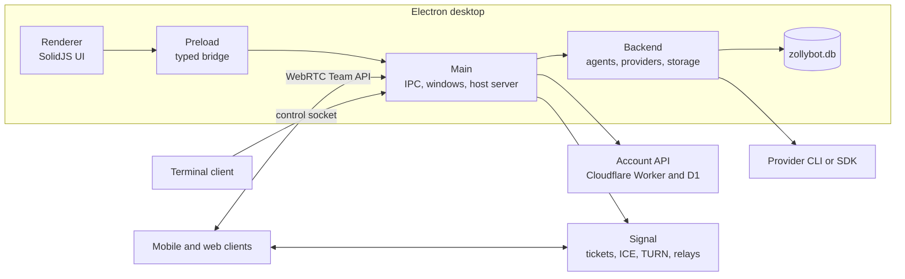

# Architecture

This document gives the mental model. The detailed topic documents are in
[docs/architecture/](../ARCHITECTURE.md). Read this page first, then the owner instructions for the
directory you change.

## The shape



## Process boundaries

| Part | Owns | Important rule |
| --- | --- | --- |
| Renderer (`src/renderer`) | SolidJS UI, feature contexts, view state | No Node.js and no main-process imports. It reaches main only through `window.zollybot`. |
| Preload (`src/preload`) | The typed bridge and the `FromMain` decoders | No business rules. Decode every value that main sends. |
| Main (`src/main`) | Electron lifecycle, windows, IPC validation, host server, OS adapters | This is the trust boundary. Validate the sender before decoding a payload. |
| Backend (`src/backend`) | `AgentService`, provider clients, SQLite, queues, browser host | It runs in the main process. The database is the source of truth. |
| Agent database host | The shared SQLite file that agents create for themselves | A separate killable process. Its runtime imports are only `node:*` and `effect`. |
| Provider CLI or SDK | One coding agent process, its login, and its session state | Provider payloads stay in the adapter. They do not leak into contracts. |
| Mobile (`apps/mobile`) | Expo and React Native client | No agent execution. It uses the Team API over WebRTC. |
| Web client | The renderer UI served at `/app` | It connects to a host over the same Team API. |
| Account API (`apps/auth-api`) | Accounts, avatars, memberships, invitations, sessions, billing | A Worker and D1 hold no chats, files, or commands. |
| Site router (`apps/site-router`) | Published sites from private R2 storage | A Worker cannot run Git or touch a repository. |
| Signal (`remote/api`) | Ticket checks, TURN credentials, SDP and ICE relay, and signed messaging ingress | It does not carry chats, files, or commands. It passes Slack, Discord, Telegram, and GitHub event bodies to the host ingress socket. |
| `zollybot-cli` (`crates/zollybot-cli`) | The terminal TUI | It reads the control socket. It keeps no office state. |

## One turn end to end

1. A view calls a function in its `<domain>-port.ts`, such as
   `src/renderer/src/features/conversation/conversation-port.ts`. The view does not read
   `window.zollybot` directly.
2. The preload exposes that call as one IPC channel. Most groups use `bridgeGroup`; only
   `attachmentImports` and the untyped `browserInput` group are written by hand.
3. A handler in `src/main/ipc/<domain>-handlers.ts` receives the call. `payloadHandler` decodes the
   payload. `routeToServer` selects the local backend or a remote team host.
4. The local path enters `AgentService` (`src/backend/agent-service.ts`). A remote path becomes a
   Team API request on the host.
5. `AgentService` starts or resumes one provider session. The provider adapter is selected in
   `src/backend/provider-drivers.ts`. Examples are `claude-client.ts`, `app-server-client.ts`, and
   the ACP clients.
6. Provider events return to `AgentService`. `DatabaseCore.dispatch` writes the projections
   (`projection_*` tables) and the event rows in one transaction.
7. `src/main/renderer-forwarders.ts` sends an `AgentEvent` to every window with `sendToRenderer`.
8. The preload decoder validates the event. The matching renderer store applies it, and the view
   renders the new state.

A remote client gets the same event stream over the Team API `events` data channel. The local
database is still the source of truth on the host.

## Data ownership

| Store | Owner | Contents |
| --- | --- | --- |
| `<userData>/zollybot.db` | Desktop backend | Agents, conversations, queues, reactions, attachments, provider-session bindings, projections, and migrations. |
| `~/ZollyBot/Agents/<id>` | Agent workspace | Files and directories that one agent can read and write. |
| `~/ZollyBot/Shared/Data/agent-data.db` | Agents | Tables that agents create for themselves. The owner is recorded in `zollybot_metadata`. |
| `browser-tabs.json` | Desktop browser host | The embedded browser's tab state. It is versioned and re-validated on read. |
| `~/.codex`, `~/.claude`, `~/.grok`, and similar | Each provider CLI | Login and resume state. It is not ZollyBot conversation storage. |
| `.agents/` in a repository | The office | Briefs, results, memory, queue, and rules. The app reads it. The app does not become its owner. |
| D1 | Account service | Accounts, memberships, invitations, logical sessions, and a copy of Stripe subscription state. |
| R2 | Account service and site router | Account avatars and published sites. |
| `.zollybot/dev-state.json` | Development tooling | Local identity and saved overrides. Git ignores it. |

The full ownership rules, including routines, mailboxes, webhooks, and approvals, are in
[State ownership](../architecture/structure.md#state-ownership).

## Agents, roles, and offices

The office layer is in progress. The current code has these parts:

- A role is a job description. The built-in catalog is `ROLE_CATALOG` in
  `src/backend/offices/role-catalog.ts`. The butler has `scope = "building"`. Other roles have
  `scope = "office"`.
- An office is one repository. `src/backend/offices/office-catalog.ts` discovers a repository that
  has the office marker `.agents/zolly/config.toml`. The office id is a hash of the real path.
- An employment puts one agent in one office, or in the building when `office_id` is null. The
  tables are `offices` and `agent_employments` (schema version 59). The reads and writes are in
  `src/backend/offices/office-store.ts`.
- `AgentService` seeds the butler and exposes `employ` and `endEmployment`. A service profile that
  predates the butler receives one on start.
- `AgentService.listAgentsWithEmployment` adds `officeId`, `officeName`, `role`, and `scope` to
  `AgentSummary`. The values come from `agent_employments`, not from the stored agent record.
- The control socket serves `GET /v1/agents` and the office routes in `src/main/server-mode.ts`.
  The terminal client reads them.
- The desktop has `src/renderer/src/features/offices/OfficeTabStrip.tsx`. The lobby, the floor
  chooser, and terminal parity are still open.

The app database holds employment and conversation state. It never copies the office's briefs,
results, or memory. Read the phased plan in
[offices implementation](../plans/2026-11-08-offices-implementation.md) before you extend this area.

## Workspace and office are different

The word "workspace" has more than one meaning in this repository. Use the qualified name in a new
type, table, or product string.

| Term | What it is | Identifier | Not |
| --- | --- | --- | --- |
| Agent workspace | The writable directory of one agent | `AgentSummary.workspacePath`, `~/ZollyBot/Agents/<id>`, `workspaceWritableRoots` | The repository that the agent works on |
| Worktree | A Git working tree for one branch of a repository | `git worktree add`, `.agents/worktrees` | The agent workspace, or an office |
| Office | One repository that carries `.agents/zolly/config.toml` | `offices.repo_path`, `AgentSummary.officeId` | A machine, a server, or a writable root |
| Building | The set of offices, plus a role with `scope = "building"` | `agent_employments.office_id = null` | A window or a tab |
| Server workspace | All state of one host | One `zollybot.db` per server | An office |
| Slack workspace | One external chat tenant | `slack_workspace_routes`, `MessagingConnection` | An office |
| Workspace shell | The desktop application frame | `WorkspaceShell`, `WorkspaceFrame` | Stored data |

The relation is: one office has many employments, one employment binds one agent to one office, and
one agent has one workspace.

```text
office (repo) 1 ── n employment n ── 1 agent 1 ── 1 workspace (dir)
```

An employment adds `officeId`, `officeName`, `role`, and `scope` to the agent payload. It does not
change `workspacePath`, the working directory, or the sandbox roots. "Workspace only" therefore
limits writes to the agent's own workspace, the shared folder, the folders that the user added, and
the temporary folders. It does not mean "only the office repository".

A worktree is not a workspace. A Git worktree is a second working tree for one branch of a
repository. It shares the repository's object database and has a branch. The development docs use
"worktree" for another checkout of ZollyBot itself, with its own profile and ports. The office plan
uses it for a per-task checkout under `.agents/worktrees`. The agent workspace is a plain directory
and usually has no Git repository. The code does not create a worktree for an agent today: the
provider starts with `cwd: agent.workspacePath`.

The current code has no link from `offices.repo_path` to an agent's working directory. An employed
agent still runs in its own workspace. If a task needs the office repository or a worktree, that
mapping is not implemented yet. Agent summaries carry the office fields; the phone `RemoteAgent`
drops them today.

## Accounts, hosts, and remote clients

1. A user signs in to the account Worker. The Worker issues a logical session.
2. A desktop becomes a team host. It publishes the host configuration and can accept members.
3. A remote client gets a ticket and opens a WebRTC peer connection. Signal carries SDP, ICE, and
   TURN credentials only. It does not carry the chat.
4. The peer uses Team API protocol v9 over three ordered data channels: `rpc`, `events`, and
   `files`. The shared code is `packages/team-client`; the host routes are in
   `src/main/team-api/`.
5. A remote client sees the same agents and conversations through the Team API. It does not run an
   agent on the phone.

Released protocol adapters are permanent. A new required field, a removed field, or a changed
meaning needs a new protocol version. An additive behavior belongs behind a capability. See
[Team API compatibility](../architecture/team-api.md#team-api-compatibility-boundary) and
[contract rules](../../packages/contracts/AGENTS.md).

## Invariants

- **The local SQLite database is the source of truth.** A remote cache may not replace it.
- **A migration preserves every shipped source schema.** No backup exists. Do not edit a shipped
  migration. Add a new version and update the latest schema for new installs.
- **Released wire formats keep their meaning.** This includes Team API protocols, IPC payloads,
  and the Signal protocol.
- **Main validates every untrusted value.** The sender check runs before the payload decoder.
- **The renderer cannot import main, backend, or preload.** Biome rejects the import.
- **Provider payloads stay inside the adapter.** Translate them at ingestion.
- **A secret never reaches a log, export, or send path.** Use `@zollybot/logging` and the secret
  registration APIs.
- **Every user-visible string is an i18n key.** A value that crosses a process boundary uses
  `sourceText`.
- **The app is local-first.** Cloudflare holds account data, not chats, files, or commands.

## Where to read more

| Topic | Document |
| --- | --- |
| Workspace map, dependency direction, state ownership | [Repository structure](../architecture/structure.md) |
| Change rules and required verification | [Change rules](../architecture/change-rules.md#change-rules) |
| Team API compatibility | [Team API](../architecture/team-api.md) |
| Agents, routines, workflows, threads, templates | [Agents](../architecture/agents.md) |
| Provider adapters, ACP, updates | [Providers](../architecture/providers.md) |
| Browser and Computer Use | [Browser](../architecture/browser.md), [Computer Use](../architecture/computer-use.md) |
| Channels, messaging, mobile notifications | [Channels and messaging](../architecture/channels-and-messaging.md) |
| Skills, plugins, MCP | [Skills and plugins](../architecture/skills-and-plugins.md) |
| Sign-in, connectors, new capabilities | [Integrations](../architecture/integrations.md) |
| Webhooks and routines | [Webhook routines](../architecture/events.md) |
| Servers, storage, billing, hosted servers | [Servers](../architecture/servers.md) |
| System design record | [Initial design](../architecture/initial-design.md) |
